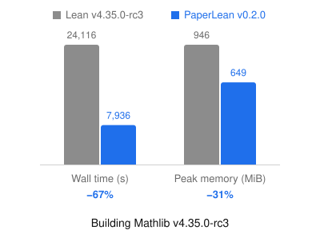
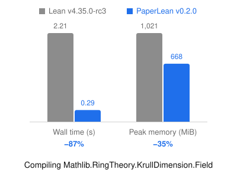
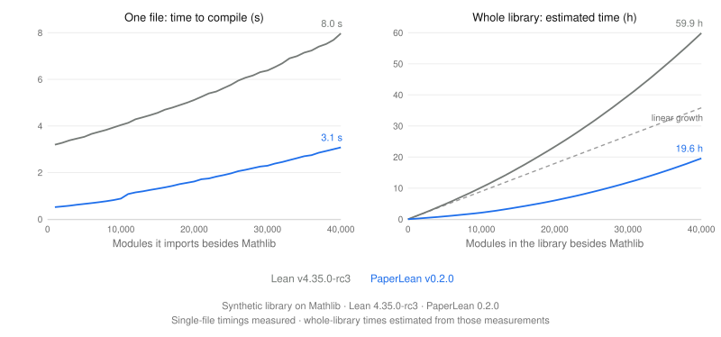

# PaperLean

A high-performance fork of the Lean 4 compiler.

## Standards

**If Lean rejects a proof whatever its resource limits, PaperLean rejects it too.**

Resource limits are options such as `maxHeartbeats` that only bound work. PaperLean can need fewer heartbeats, so a proof that runs out of them under Lean may pass under PaperLean.

The guarantee is about mathematical proofs, not Lean as a programming language. Adversarial code, written to exploit Lean's internals or PaperLean's caches, is not covered.

The kernel is Lean's, unmodified, and build caches are compatible with official Lean's.

## Performance

 

Apple M5 Max. Mathlib is built whole with `paperlean prepare`: wall time summed over its 8,564 modules, peak memory averaged. `KrullDimension.Field` is an extreme case: two theorems in 26 lines that import about 2,000 modules, so nearly all of its time goes to import.



Lean's import time grows with the number of modules imported, so building a library takes time quadratic in its size. Measured on a hypothetical library on Mathlib whose modules each import all earlier ones.

## How to use

```bash
elan toolchain install qinz1yang/PaperLean:v0.2.1-lean4.35.0-rc3
elan run qinz1yang/PaperLean:v0.2.1-lean4.35.0-rc3 paperlean install
```

In a project on Lean `v4.35.0-rc3`:

```bash
lake exe cache get
paperlean prepare
paperlean build
```

`lake build` stays official Lean. `paperlean prepare` compiles the tactics, elaborators and linters of the dependencies to native code, and packs their built `.olean` files with prebuilt import states, into `.lake/paperlean/`. Every declaration of the project is still elaborated, with exact reuse, and checked by the kernel. Releases are for Linux x86-64 and macOS 26 on Apple silicon. Where normal code is not accelerated, `paperlean build` says so: a short summary at its end of what was not reused, why, and where.

## Optimizations

- **Import** — olean packs, prebuilt simp and instance states, parallel header reading.
- **Meta code** — tactics, elaborators and linters of dependencies run as native code.
- **Reuse** — type class results and section variables across commands.
- **Build** — release toolchains are built with PGO, and BOLT on Linux; the build in this repository does not do this.

## License

Apache 2.0, as Lean.

<!-- Modified by PaperLean. -->
