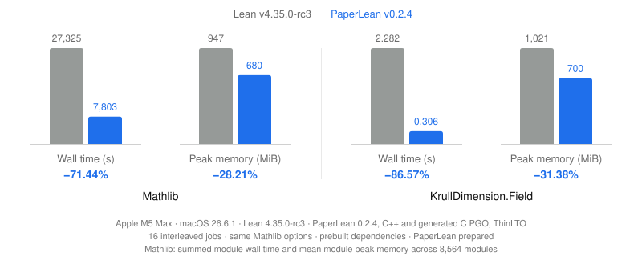
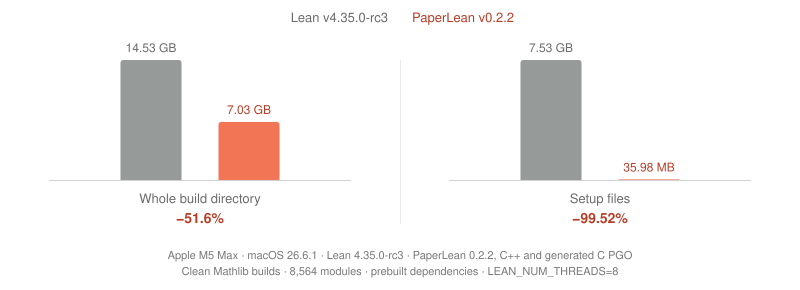
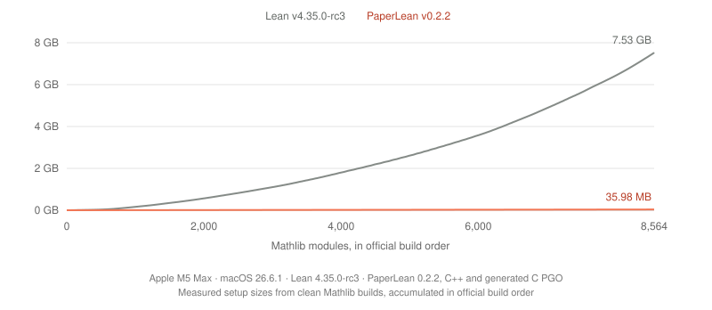

# PaperLean

A high-performance fork of the Lean 4 compiler.

## Standards

**If Lean rejects a proof at every resource limit, PaperLean rejects it too.**

PaperLean preserves mathematical statements and results. Lean’s unmodified kernel checks every proof, and build caches work with either toolchain.

A proof that exhausts Lean’s heartbeat budget may pass in PaperLean. The guarantee covers ordinary mathematical code. Adversarial meta-code that exploits compiler internals or caches is outside its scope.

## Performance

### Time and memory



### Disk usage



> Setup files tell Lean where to find imported build artifacts. Lake repeats the paths of all transitive imports in each module’s setup. PaperLean puts the import graph in one shared index and gives each module a reference to it.

## How to use

```bash
elan toolchain install qinz1yang/PaperLean:v0.2.2-lean4.35.0-rc3
elan run qinz1yang/PaperLean:v0.2.2-lean4.35.0-rc3 paperlean install
```

In a project on Lean `v4.35.0-rc3`:

```bash
lake exe cache get
paperlean prepare
paperlean build
```

`lake build` stays official Lean. `paperlean prepare` compiles the tactics, elaborators and linters of the dependencies to native code, and packs their built `.olean` files with prebuilt import states. The packs and native code are kept per package in a cache that all projects share (`~/.cache/paperlean`, or `PAPERLEAN_CACHE_DIR`), so a second project on the same Mathlib reuses them, and running `paperlean prepare` again redoes only the packages whose files changed; `paperlean clean --cache` deletes what no project uses. Every declaration of the project is still elaborated, with exact reuse, and checked by the kernel. Releases are for Linux x86-64 and macOS 26 on Apple silicon. Where normal code is not accelerated, `paperlean build` says so: a short summary at its end of what was not reused, why, and where.

## Quadratic growth in Lean

Each module pays to load its transitive imports. In a library where every module reaches the earlier ones, the first few modules are cheap, and the later ones load progressively more. The total import work grows as the sum of those closure sizes, which is quadratic in this case. PaperLean reduces the cost of loading those imports.


Lake also writes each module’s transitive artifact paths to its setup file. Even a chain of modules, each importing only its predecessor, yields `n(n−1)/2` path entries across `n` setup files. The same duplication can arise as Mathlib or a downstream library grows. PaperLean’s shared index records the `n−1` direct imports in that chain once, with one reference per module.



As Mathlib and other Lean libraries grow, including those maintained by AI, these costs can increase quadratically. PaperLean replaces quadratic setup duplication with storage linear in the number of modules and direct imports, and reduces the cost of loading transitive imports.

## Optimizations

- **Import** — olean packs, prebuilt simp and instance states, parallel header reading.
- **Meta code** — tactics, elaborators and linters of dependencies run as native code.
- **Reuse** — type class results and section variables across commands.
- **Setup** — a shared index replaces repeated transitive artifact paths in `paperlean build`.
- **Build** — release toolchains are built with PGO, and BOLT on Linux; the build in this repository does not do this.

## License

Apache 2.0, as Lean.

<!-- Modified by PaperLean. -->
