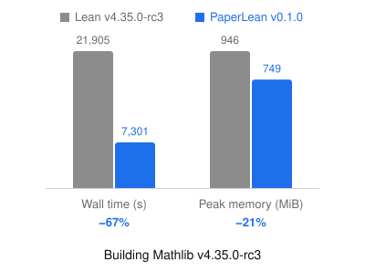
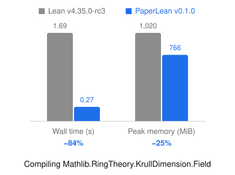

# PaperLean

A high-performance fork of the Lean 4 compiler.

## Standards

**If Lean rejects a file whatever its resource limits, PaperLean rejects it too.**

Resource limits are the options that only bound work, such as `maxHeartbeats`, `maxRecDepth` and `synthInstance.maxHeartbeats`. PaperLean's optimizations can lower the heartbeats a theorem needs, so a proof that runs out of heartbeats under Lean may pass under PaperLean.

The kernel is Lean's, unmodified. Build caches are interchangeable with official Lean's in both directions.

## Performance

 

Apple M5 Max. Mathlib is built whole with `paperlean prepare`: wall time summed over its 8,564 modules, peak memory averaged. `KrullDimension.Field` is an extreme case: two theorems in 26 lines that import about 2,000 modules, so nearly all of its time goes to import.

## How to use

```bash
elan toolchain install qinz1yang/PaperLean:v0.1.0-lean4.35.0-rc3
elan run qinz1yang/PaperLean:v0.1.0-lean4.35.0-rc3 paperlean install
```

In a project on Lean `v4.35.0-rc3`:

```bash
lake exe cache get
paperlean prepare
paperlean build
```

`lake build` stays official Lean. `paperlean prepare` compiles the tactics, elaborators and linters of the dependencies to native code, and packs their built `.olean` files with prebuilt import states, into `.lake/paperlean/`. Every declaration of the project is still elaborated and checked by the kernel. Releases are for Linux x86-64 and macOS 26 on Apple silicon.

## Optimizations

- **Import** — olean packs, prebuilt simp and instance states, parallel header reading.
- **Meta code** — tactics, elaborators and linters of dependencies run as native code.
- **Reuse** — type class results and section variables across commands.
- **Build** — PGO, and BOLT on Linux.

## License

Apache 2.0, as Lean.
